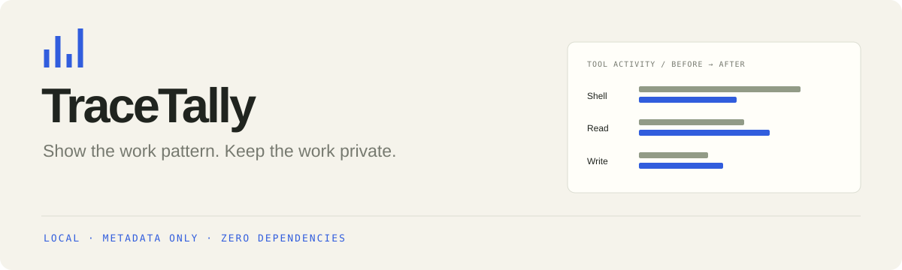

<p align="center"></p>

# TraceTally

[](https://github.com/4onv/trace-tally/actions/workflows/ci.yml)

**Compare agent runs without putting the conversation in the report.**

TraceTally turns two local agent traces into a small, shareable comparison of tool activity, errors, and recorded durations. It exports a deliberately limited set of categories and numbers. Prompts, responses, source code, commands, file paths, original tool names, call IDs, and absolute timestamps stay out of the generated artifacts.

It is a Node.js CLI with **zero dependencies, no model API, and no server**.

## Try the demo

[Download the standalone synthetic report](https://github.com/4onv/trace-tally/releases/download/v0.2.1/sample-report.html) and open it locally. No installation is needed to view it.

To run your own comparisons, install the release archive with [Node.js 22 or newer](https://nodejs.org/):

```sh
npm install -g https://github.com/4onv/trace-tally/releases/download/v0.2.1/4onv-trace-tally-0.2.1.tgz
trace-tally demo
```

Open `.trace-tally/demo/report.html` in a browser. The demo uses **synthetic traces**, not measured production improvements. It requires no account, dependency installation, or Docker.

The [release](https://github.com/4onv/trace-tally/releases/tag/v0.2.1) includes SHA-256 checksums. This project is distributed through GitHub releases; the package has zero runtime dependencies. For development from a checkout, use `node bin/trace-tally.mjs` in place of `trace-tally`.

## Compare your runs

Select the files you want to inspect; TraceTally does not automatically scan your home directory.

```sh
trace-tally compare before.jsonl after.jsonl
```

The default output directory is `.trace-tally/comparison`:

| Artifact | What it contains |
| --- | --- |
| `comparison.json` | Projected metrics for the baseline and candidate runs |
| `report.html` | A standalone visual comparison that can be opened locally |

The default `auto` format accepts supported Claude Code JSONL records and TraceTally's neutral event schema. Select a format explicitly when needed:

```sh
trace-tally compare before.jsonl after.jsonl --format claude --out .trace-tally/review
```

For a simple automation gate, use `--fail-on-more-errors`. It exits with code `1` when the candidate has more recorded error calls than the baseline:

```sh
trace-tally compare before.jsonl after.jsonl --fail-on-more-errors
```

That is an absolute error-count gate, not an error-rate comparison, a test of statistical significance, or evidence that either run completed its task correctly.

## Record your own tool operations

Version 0.2 includes a small recorder for JavaScript integrations. Install the package in your project to use its API:

```sh
npm install https://github.com/4onv/trace-tally/releases/download/v0.2.1/4onv-trace-tally-0.2.1.tgz
```

Wrap the operations you already run, using a fixed category instead of a custom tool name:

```js
import { createRecorder } from '@4onv/trace-tally/recorder';
import { writeFile } from 'node:fs/promises';

const recorder = createRecorder();
const result = await recorder.run('read', async () => {
  // Call your existing tool here. Its result is returned unchanged.
  return { value: 42 };
});
await writeFile('run.jsonl', recorder.toJSONL());
```

Then compare two recordings with the existing CLI. The recorder never stores operation arguments, return values, error messages, or stack traces. Concurrent calls are paired correctly, and original thrown errors are rethrown. A working synthetic example is available in the source checkout with `node examples/record-tools.mjs`.

The recorder holds a bounded run in memory. Its raw neutral event log contains generated call IDs and timestamps; `inspect` and `compare` remove those fields from exports. See [the recorder API](docs/recorder.md) for limits and clock behavior.

## Inspect a single trace

```sh
trace-tally inspect session.jsonl --format auto
```

This writes only `receipt.json` to `.trace-tally/receipt`. Use it when you need the projected data without a comparison report.

To rebuild the HTML from an existing comparison:

```sh
trace-tally report .trace-tally/comparison/comparison.json --out .trace-tally/rebuilt
```

## What the comparison means

- Tools are grouped into fixed categories: **shell, read, write, search, web, agent, and other**. Unknown tool names become `other`.
- Calls and results are paired internally. Their original IDs are not exported.
- A duration is available only when both timestamps are valid and the result is not earlier than the start. Missing timing is not zero time.
- Adding call durations does **not** produce wall-clock runtime. Calls may overlap, and the trace may omit activity.
- Fewer errors or tool calls may be useful evidence to investigate. They do not establish better code, a completed task, or a causal improvement.
- TraceTally does not report tokens, money, model quality, or hidden reasoning.

See [the input format and CLI reference](docs/format.md) for examples and limits.

## Privacy through smaller exports

TraceTally builds exports from allowed fields rather than embedding the transcript and trying to remove sensitive words afterward. It does not upload your input or output. Reports require no remote assets.

**Metadata is not guaranteed anonymous.** Tool categories, activity counts, durations, and error patterns can still reveal how work happened. Review every artifact before sharing, and retain the original trace under your own access controls. See [SECURITY.md](SECURITY.md).

One input file is treated as one run. TraceTally does not merge a multi-agent execution tree, certify log authenticity, or prove a task succeeded. Native transcript formats can change; supported shapes are documented in [docs/format.md](docs/format.md).

## Development

```sh
git clone https://github.com/4onv/trace-tally.git
cd trace-tally
node --test
node bin/trace-tally.mjs demo
npm pack --ignore-scripts
npm run check:package -- 4onv-trace-tally-0.2.1.tgz
```

CI installs the packed archive offline into a fresh temporary project and exercises the installed CLI and public APIs on Node 22/24, Linux and Windows.

Useful contributions include carefully tested format adapters, clearer missing-data diagnostics, and representative synthetic fixtures. Start with [CONTRIBUTING.md](CONTRIBUTING.md).

[Research and existing alternatives](docs/research-2026-10-31.md) explain why this project focuses on a small comparison artifact rather than full transcript playback.

MIT licensed.
